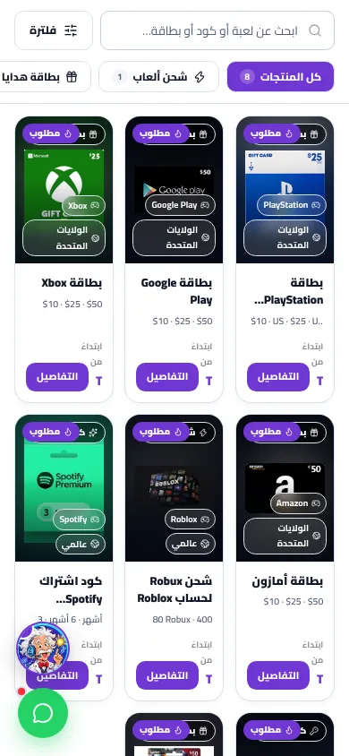
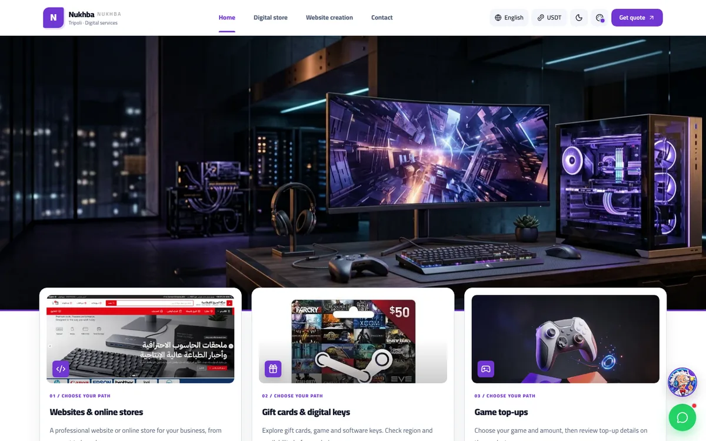
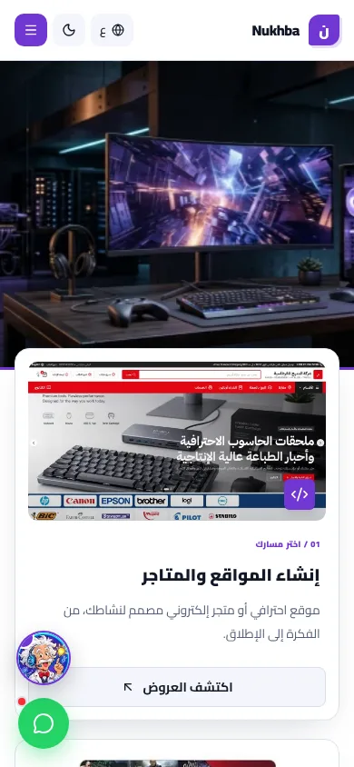
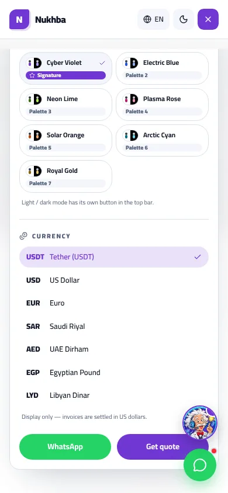
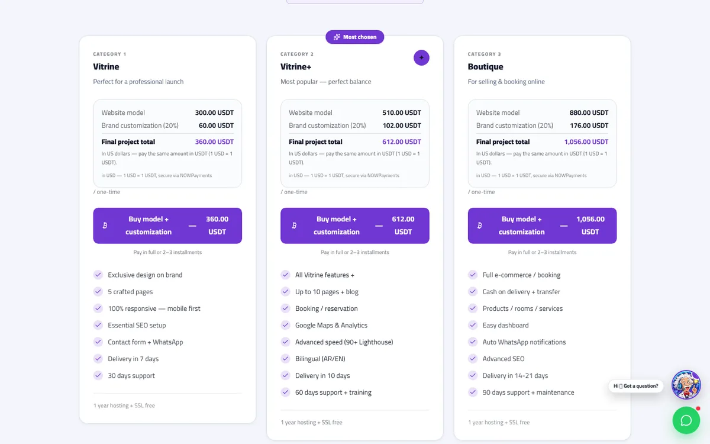
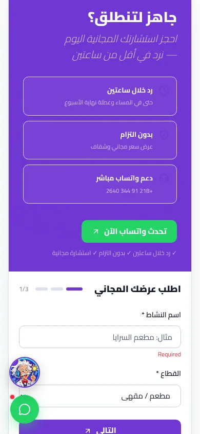

# Audit design — confort visuel et navigation

**Site :** Nukhba / `mon-site`  
**Date :** 3 novembre 2026  
**Branche auditée :** `arena/f2a12ef9-mon-site`  
**Question posée :** « Est-ce que la navigation est confortable ou ennuyeuse ? »  
**Périmètre :** pages publiques, pas l’admin.

---

## 1. Verdict rapide

**Le site n’est pas ennuyeux : il est plutôt trop sollicitant.**  
L’identité visuelle est forte, les pages sont riches, les cartes sont soignées et le mode sombre existe. Mais le confort se dégrade dès qu’on veut **agir** : trouver un produit, lire un prix, ouvrir le menu, demander un devis.

- **Confort visuel global : moyen.** Bonne base de couleurs et de typographie, mais trop de micro-textes, d’opacités réduites, de badges et d’animations concurrentes.
- **Navigation desktop : correcte mais perfectible.** Les 4 entrées principales sont simples ; la boutique devient dense et les repères de navigation disparaissent au défilement.
- **Navigation mobile : à corriger en priorité.** La boutique garde 3 colonnes, les prix sont tronqués, le menu est très long et les boutons flottants chevauchent des actions.
- **Ennui : faible.** Le risque n’est pas que le visiteur s’ennuie, mais qu’il se fatigue, hésite ou abandonne.

> Phrase de synthèse : **« Joli et ambitieux, mais pas encore assez reposant ni assez direct pour convertir sereinement. »**

---

## 2. Méthode et limites

Audit réalisé sur la prévisualisation locale Next.js, avec le contenu par défaut et un catalogue local de démonstration de **8 produits** (`DATABASE_URL` absent). Les conclusions de structure/CSS restent applicables, mais le catalogue production peut être plus grand.

- Navigateur Chromium piloté par Playwright.
- Largeurs testées : **320, 360, 390, 768, 1024, 1280, 1440 px**.
- Langues : **arabe RTL** et **anglais LTR**.
- Modes : **clair** et **sombre**.
- Pages principales : accueil, `/codes`, `/creation-sites`, `/contact`, fiche produit.
- Parcours testés : ouverture menu, recherche boutique, filtre catégorie, état vide, retour depuis fiche produit, formulaire de devis, chatbot, défilement.
- **28 configurations navigateur explorées**, complétées par **21 contrôles axe-core** avec l’indicateur de développement Next.js masqué et exclu de l’analyse.
- Tests design existants : `node --test scripts/vivid-design.test.mjs` → **9/9 réussis**.

Limites : pas de test utilisateurs réels, pas de mesure Lighthouse production, pas d’analytics, pas de validation WCAG complète. Les résultats axe sont des signaux automatisés, pas une certification.

---

## 3. Évaluation par critère

| Critère | Évaluation | Pourquoi |
|---|---:|---|
| Identité visuelle | Bonne | Palette gaming cohérente, cartes soignées, vrais visuels locaux. |
| Lisibilité de base | Bonne à moyenne | Fond/texte principaux lisibles, mais beaucoup de textes secondaires trop petits ou trop transparents. |
| Compréhension immédiate de l’offre | Moyenne | L’accueil montre une grande image avant d’expliquer clairement les deux métiers. |
| Navigation principale | Bonne | 4 destinations seulement, état actif visible. |
| Navigation boutique | Moyenne à faible | Trop de niveaux de catégories, état parfois contradictoire, repères perdus au scroll. |
| Confort mobile | Faible | Prix tronqués, menu long, chevauchements, cibles parfois petites. |
| Charge cognitive | Élevée par endroits | Badges, compteurs, filtres, thèmes, devises, chatbot, WhatsApp, CTA répétés. |
| Accessibilité technique | À corriger | Contrastes insuffisants sur composants réels, labels de formulaire, noms accessibles, focus du menu. |
| Sensation d’ennui | Faible | Le site est vivant ; le problème est la fatigue, pas le vide. |

---

## 4. Constats prioritaires

### P0 — Boutique mobile : les prix sont tronqués

**Gravité : critique.**  
Sur `/codes` à **390 px**, la grille garde **3 colonnes**. Chaque carte mesure environ **111 px** de large. Le titre fait 13 px, les dénominations 10,5 px, le libellé « à partir de » 9,5 px, et le bouton Détails 32 px de haut.

Mesure clé : sur les **8 produits testés**, le conteneur de prix affiche environ **7 px** de large en arabe pour un contenu d’environ **71 px**. Résultat : le prix est coupé, parfois réduit à un caractère. À **320 px**, la largeur disponible tombe à **0 px** dans le test.

**Impact visiteur :** impossibilité de comparer rapidement, perte de confiance, abandon avant la fiche produit.

**Correction recommandée :**
- Mobile : **1 colonne sous 360 px**, **2 colonnes entre 360 et 767 px**, ou cartes horizontales pleine largeur.
- Ne jamais mettre prix + bouton sur la même ligne dans une carte < 180 px.
- Prix sur sa propre ligne, bouton pleine largeur dessous.
- Supprimer `truncate` du prix ; autoriser le retour à la ligne.
- Garder 3 colonnes seulement à partir d’un espace utile suffisant, 4 colonnes en grand écran.

**Critère d’acceptation :** à 320, 360 et 390 px, en AR/EN et clair/sombre, **aucun prix tronqué**, aucun badge superposé, bouton Détails ≥ 44 px.

**Fichiers concernés :** `src/components/digital-catalog.tsx` lignes ~657, 789–810.

---

### P1 — Accueil : l’image arrive avant le message

**Gravité : importante.**  
L’accueil est dominé par une illustration gaming. Le H1 est réservé aux lecteurs d’écran (`sr-only`) : le hero ne présente pas de titre principal visible. Sur desktop 1440×900, le hero mesure environ **562 px** et le premier titre de carte n’arrive qu’à **y ≈ 828 px**. Sur mobile 390×844, le hero mesure **340 px** et le premier titre de carte arrive à **y ≈ 619 px**.

**Impact visiteur :** le site est beau, mais on comprend tardivement qu’il vend à la fois des sites web et des produits numériques. Pour une agence web, l’image gaming peut aussi brouiller le positionnement.

**Correction recommandée :**
- Afficher un H1 court : « Créez votre site web. Achetez vos codes et cartes digitales. »
- Ajouter une phrase de réassurance et deux CTA : « Voir les offres site web » / « Explorer la boutique ».
- Réduire le hero ou le remplacer par un bloc mixte texte + visuel.
- Garder l’image gaming comme ambiance, pas comme seul message.

**Critère d’acceptation :** en moins de 5 secondes, un visiteur doit pouvoir dire ce que le site propose et choisir son parcours sans défiler.

**Fichiers concernés :** `src/components/sections/hero.tsx`, `src/components/sections/home-gateway.tsx`, `src/app/gaming.css`.

---

### P1 — Menu mobile : trop long, trop de réglages, action principale trop bas

**Gravité : importante.**  
Le menu mobile contient bien les 4 liens principaux, mais il déploie aussi **7 thèmes** et **7 devises** avant les actions WhatsApp / devis. Mesure : contenu scrollable ≈ **1180 px** pour une zone visible ≈ **760 px**. Le bouton « Get quote » est initialement à **y ≈ 1163 px**, donc sous l’écran.

Le menu n’a pas de piège de focus : après les éléments du menu, le clavier atteint la page en arrière-plan. Les boutons flottants restent en `z-index: 70` au-dessus du menu en `z-index: 40`.

**Impact visiteur :** l’action commerciale est noyée dans des préférences secondaires. Le visiteur doit défiler dans le menu pour demander un devis.

**Correction recommandée :**
- Ordre : liens principaux → CTA devis → WhatsApp → réglages repliés.
- Mettre thèmes/devises dans un accordéon « Personnaliser l’affichage ».
- Masquer chatbot/WhatsApp quand le menu est ouvert.
- Ajouter `role="dialog"`, `aria-modal`, focus trap, retour du focus au bouton d’ouverture.
- Garder Échap, déjà fonctionnel.

**Critère d’acceptation :** le CTA devis est visible sans défilement dans le menu à 390×844 ; aucun élément flottant ne chevauche le menu.

**Fichiers concernés :** `src/components/navbar.tsx`, `src/components/theme-switcher.tsx`, `src/components/currency-switcher.tsx`, `src/components/whatsapp-float.tsx`, `src/components/site-chatbot.tsx`.

---

### P1 — Contrastes : la base est bonne, les composants réels échouent parfois

**Gravité : importante.**  
Les tests de tokens de couleur passent, mais l’application réelle ajoute des `opacity-50`, `opacity-60`, `opacity-65` et un vert WhatsApp clair. Exemples mesurés par axe :

| Élément | Contraste mesuré | Attendu pour petit texte |
|---|---:|---:|
| Texte blanc des CTA WhatsApp sur `#25D366` | **1,98:1** | ≥ 4,5:1 |
| Mention « NUKHBA » sous le logo, 10 px | **3,96:1** | ≥ 4,5:1 |
| Libellé « From / à partir de » à 9,5 px, opacity 50 | **3,37:1** | ≥ 4,5:1 |
| Notes de tarif à 10 px, opacity 55 | **3,92:1** | ≥ 4,5:1 |
| Texte secondaire du bloc CTA violet | **3,40–3,43:1** | ≥ 4,5:1 |

**Impact visiteur :** fatigue visuelle, information secondaire difficile à lire, particulièrement sur mobile ou en lumière forte.

**Correction recommandée :**
- Ne pas utiliser `opacity` pour du texte essentiel ; utiliser un token `--muted-foreground` déjà contrasté.
- WhatsApp : fond vert plus foncé, par exemple `#0B6B3A` avec texte blanc, ou texte très sombre sur vert clair.
- Porter les micro-libellés à au moins 12 px, idéalement 13–14 px.
- Ajouter un test de contraste sur composants rendus, pas seulement sur tokens.

**Fichiers concernés :** `src/components/sections/pricing.tsx`, `src/components/sections/cta-form.tsx`, `src/components/digital-catalog.tsx`, `src/app/(site)/contact/contact-client.tsx`.

---

### P1 — Formulaire de devis : erreurs anglaises en arabe et budget vide

**Gravité : importante.**  
Le formulaire en 3 étapes est une bonne idée, mais l’exécution casse la confiance :
- En arabe, l’erreur affichée est **« Required »** ou **« Too small: expected string to have >=2 characters »**.
- Le focus reste sur le bouton « التالي » au lieu d’aller au champ invalide.
- Les labels ne sont pas associés aux champs (`for`/`id`), axe signale `select-name`.
- Le budget par défaut est `1500-2500`, valeur absente des options ; le select arrive donc vide/`selectedIndex = -1`.

**Impact visiteur :** sentiment de bug, hésitation, abandon. C’est un point de conversion majeur.

**Correction recommandée :**
- Messages d’erreur localisés AR/EN.
- `aria-invalid`, `aria-describedby`, focus sur le premier champ invalide.
- Associer chaque label à son champ.
- Aligner `defaultValues.budget` sur une option existante, ou ajouter un placeholder « Choisir un budget ».
- Réduire le bloc promotionnel violet au-dessus du formulaire sur mobile.

**Fichiers concernés :** `src/components/sections/cta-form.tsx`.

---

### P1 — Navigation au défilement : les repères disparaissent

**Gravité : importante.**  
Le header est en `position: relative`, pas sticky. Sur une page longue comme `/creation-sites` (**≈ 11 058 px** en mobile arabe, soit plus de 13 écrans), le visiteur perd le menu principal. Dans la boutique, seule la barre de recherche/filtres reste collante ; le header et les catégories principales disparaissent.

**Impact visiteur :** sensation de page longue, difficulté à revenir en arrière ou changer de parcours.

**Correction recommandée :**
- Header sticky compact, ou bouton menu flottant non chevauchant.
- Sur `/creation-sites`, rendre la nav d’ancres sticky : Offres → Exemples → Étapes → Devis.
- Ajouter un lien « Retour en haut » discret.
- Dans la boutique, garder un fil d’Ariane / catégorie active visible.

**Fichiers concernés :** `src/components/navbar.tsx`, `src/components/website-creation-view.tsx`, `src/components/digital-catalog.tsx`.

---

### P1 — Boutique : trois systèmes de catégories et état contradictoire

**Gravité : importante.**  
La boutique affiche :
1. une nav de catégories SEO,
2. des chips de familles dans la barre collante,
3. un rail latéral « Sections / Plateformes / Régions / Prix ».

Test : depuis `/codes?kind=gift_card`, cliquer sur la chip « شحن ألعاب » affiche 1 produit de type top-up, mais l’URL reste `kind=gift_card` et la nav supérieure garde « Gift cards » active. Le retour depuis une fiche produit réinitialise aussi le filtre local.

**Impact visiteur :** « Où suis-je ? Pourquoi le résultat ne correspond pas à la catégorie active ? »

**Correction recommandée :**
- Une seule source de vérité pour la catégorie : URL.
- Synchroniser chips, rail et nav avec `?kind=`.
- Conserver recherche/filtres dans l’URL ou dans l’état de navigation au retour.
- Sur mobile, remplacer le rail par un panneau de filtres ouvert à la demande, avec bouton « Voir X résultats ».

**Fichiers concernés :** `src/components/digital-store-view.tsx`, `src/components/digital-catalog.tsx`.

---

### P2 — Sollicitations visuelles : chatbot, WhatsApp, halos, pastilles

**Gravité : modérée.**  
Le chatbot flotte en permanence, pulse, affiche une bulle toutes les 26 secondes pendant 9 secondes. WhatsApp ajoute une pastille rouge. La boutique a une pastille pulsante, la carte contact une pastille `animate-ping`. En `prefers-reduced-motion`, le halo/flottement du chatbot s’arrêtent, mais certains `animate-pulse` restent actifs.

**Impact visiteur :** l’œil est rappelé en bas de écran au lieu de lire l’offre. Cela peut donner une impression d’insistance commerciale.

**Correction recommandée :**
- Un seul bouton d’aide flottant, ou un groupe discret.
- Bulle d’accueil une seule fois, fermable, pas de boucle.
- Pas de pastille rouge sans notification réelle.
- Désactiver toutes les animations décoratives en `prefers-reduced-motion`.
- Masquer les flotteurs pendant menu, formulaire focused, checkout ou chatbot ouvert.

**Fichiers concernés :** `src/components/site-chatbot.tsx`, `src/components/whatsapp-float.tsx`, `src/app/globals.css`, `src/app/(site)/contact/contact-client.tsx`.

---

### P2 — Micro-typographie et cibles tactiles

**Gravité : modérée.**  
Exemples relevés :
- titres produits : 13 px ;
- dénominations : 10,5 px ;
- « From » : 9,5 px ;
- boutons header : 36×36 px ;
- fermeture chatbot : 28×28 px ;
- bouton Détails produit : 32 px de haut.

**Correction recommandée :**
- Texte secondaire minimum 12–13 px, texte courant 15–16 px.
- Cibles tactiles principales ≥ 44×44 px.
- Réserver les très petits textes aux métadonnées non essentielles.

---

## 5. Ce qui fonctionne déjà bien

- **4 destinations principales** seulement : accueil, boutique, création de sites, contact.
- État actif visible dans la navigation.
- Vraie gestion **RTL arabe** et LTR anglais.
- Polices auto-hébergées, pas de dépendance Google Fonts au premier rendu.
- Mode sombre prévu, pas un simple filtre inversé.
- Aucun débordement horizontal détecté sur les largeurs testées.
- Recherche boutique fonctionnelle : « steam » passe de 8 à 1 résultat ; état vide présent ; reset fonctionnel.
- Images locales et replis visuels, pas de gros rectangles gris.
- Zoom hero fini en 5 s, pas de carrousel infini sur l’accueil.
- Tests de tokens design : 9/9.

---

## 6. Plan d’action recommandé

### Lot 1 — Urgent, 1 à 2 jours
1. Corriger la grille mobile et les prix tronqués.
2. Réordonner le menu mobile et replier thèmes/devises.
3. Masquer les flotteurs quand le menu est ouvert.
4. Corriger les contrastes WhatsApp, prix, notes tarifaires, CTA.
5. Localiser les erreurs du formulaire et corriger le budget vide.

### Lot 2 — Confort de navigation, 2 à 4 jours
1. Rendre le header ou la nav d’ancres sticky.
2. Synchroniser catégorie boutique / URL / chips / rail.
3. Ajouter un H1 visible et deux CTA sur l’accueil.
4. Réduire la hauteur du hero et des blocs promotionnels mobiles.
5. Ajouter focus trap au menu mobile.

### Lot 3 — Calme et cohérence, 1 à 2 jours
1. Réduire animations décoratives et bulles répétées.
2. Harmoniser tailles minimales et cibles tactiles.
3. Ajouter tests Playwright : prix non tronqués, menu sans chevauchement, contrastes composants.
4. Tester avec 5 utilisateurs réels : 2 acheteurs de cartes, 2 prospects site web, 1 utilisateur mobile uniquement.

---

## 7. Réponse finale à la question

**La navigation n’est pas ennuyeuse ; elle est inégalement confortable.**  
Sur desktop, elle reste assez simple grâce aux 4 entrées principales. Sur mobile, elle devient fatigante et parfois bloquante : prix illisibles, menu trop long, flotteurs gênants, catégories contradictoires.

La priorité n’est pas d’ajouter plus de design, mais de **calmer l’interface, rendre les prix lisibles, raccourcir les chemins d’action et restaurer des repères stables**.
